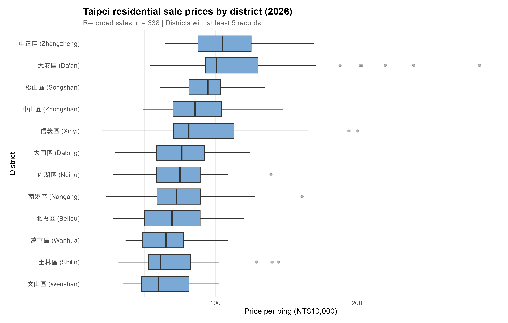
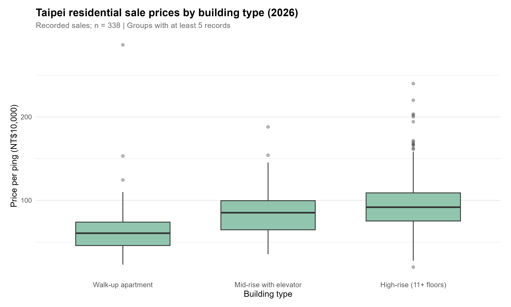

## Research question

Which property and location characteristics are associated with Taipei residential price per ping, and do these relationships differ across locations and market segments? These figures are descriptive, not causal.

## Data and sample

We use the Taipei City Actual Price Weekly Data snapshot `RPWeekData(1151103).csv`. We keep recorded sales categorized as house-and-land transactions, with or without parking, and exclude rental, pre-sale, land-only, and parking-only transactions. We require positive, nonmissing unit price and area. For the plots, we focus on 2026 transactions because historical coverage in this weekly snapshot is uneven. These figures are not necessarily representative of all 2026 Taipei sales.

```{r}
source('script/1_prepare_data.R', encoding='UTF-8')
source('script/2_create_figures.R', encoding='UTF-8')
```

## Figure 1: Prices across districts

Figure 1: Housing Prices Across Taipei Districts

Figure 1 compares residential sale prices per ping across 12 districts in Taipei using 338 recorded transactions from 2026. The results show noticeable differences in median prices across districts. Zhongzheng has the highest median price at approximately NT$1.05 million per ping, followed by Da'an at NT$1.01 million. In contrast, Wenshan has the lowest median at approximately NT$599,000 per ping. The figure also shows considerable variation within some districts, particularly Da'an and Xinyi, where several transactions have unusually high prices.

These differences suggest that location is associated with residential property prices. However, the observed differences may also reflect variations in property characteristics across districts. In our planned analysis, we will include district indicators alongside building type, floor area, and other available property characteristics in a multiple regression model to examine whether district-level price differences remain after accounting for these factors.

## Figure 2: Prices across building types

Figure 2: Housing Prices by Building Type

Figure 2 compares residential sale prices per ping across three building categories: walk-up apartments, mid-rise buildings with elevators, and high-rise buildings. High-rise buildings have the highest median price at approximately NT$918,000 per ping, followed by mid-rise buildings at NT$852,000 and walk-up apartments at NT$606,000. The median price of high-rise properties is approximately 52% higher than that of walk-up apartments. High-rise properties also show substantial price variation, including several high-priced outliers.

These patterns are consistent with our hypothesis that building characteristics are associated with housing prices. Nevertheless, the differences cannot be attributed solely to building type, since location, property size, and other characteristics may also influence prices. Our next step will be to estimate a multiple regression model that includes building type and district alongside other available variables. This will help us assess whether the observed building-type differences persist after controlling for these characteristics.


## Limitations and next steps

The weekly snapshot contains relatively just a few indicators. Therefore we do not estimate building-age relationships etc. So, before the final report, we will seek more complete historical data, check variable definitions and unusual observations, and estimate multivariable models to assess whether the descriptive patterns persist after adjustment.
